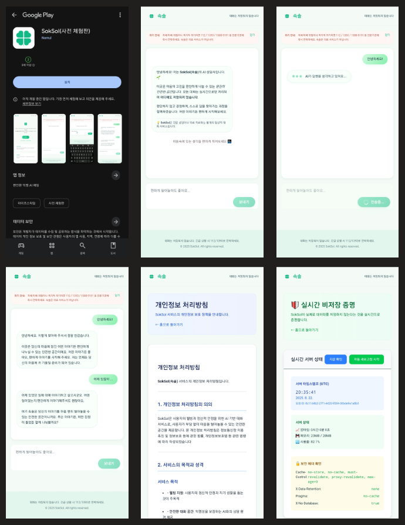

# SokSol (속솔) - [✨바로가기](https://soksol.vercel.app)

## [🎬 Youtube Shorts 시연영상 보러가기](https://youtube.com/shorts/EcTReJ0OemI?feature=share)




---

## 🌟 프로젝트 소개

SokSol(속솔)은 **완전 익명 AI 상담 서비스**입니다. 회원가입 없이 누구나 마음속 고민을 털어놓고, 판단 없는 AI와 대화하며 스스로를 정리해 나갈 수 있습니다.

### ✨ 핵심 가치

- 🔒 **완전한 익명성** - 회원가입, 로그인 없음
- 🚫 **무저장 정책** - 대화 내용 영구 보관 안함  
- 💝 **판단 없는 경청** - AI가 사용자를 판단하지 않고 공감
- 🌱 **자기 성찰 지원** - 스스로 답을 찾는 과정 도움

### 🚀 주요 기능

| 기능 | 설명 |
|------|------|
| **즉시 시작** | 회원가입 없이 바로 대화 시작 |
| **AI 상담** | Google Gemini 기반 실시간 응답 |
| **보안 강화** | 다층 보안 및 개인정보 보호 |
| **크로스 플랫폼** | 웹 + 안드로이드 앱 지원 |

---

## 🛠 기술 스택

<table>
<tr>
<td width="50%">

### 🌐 웹앱
- **Framework**: Next.js 15.4.6
- **Language**: TypeScript 5+
- **Styling**: Tailwind CSS v4
- **AI Engine**: Google Gemini API
- **Deployment**: Vercel

</td>
<td width="50%">

### 📱 모바일
- **Framework**: React Native 0.81.0
- **WebView**: react-native-webview
- **Platform**: Android (iOS 준비됨)
- **Build**: Gradle + AAB/APK

</td>
</tr>
</table>

### 🛡 보안 & 모니터링
- **Error Tracking**: Sentry (PII 필터링)
- **Security**: CSP, HSTS, Rate Limiting  
- **CI/CD**: GitHub Actions (보안 스캔, 테스트)

---

## 🚀 빠른 시작

### 📋 사전 요구사항
- Node.js ≥ 18
- Android Studio (모바일 개발 시)
- Python 3.6+ (자동화 스크립트용)

### ⚡ 설치 및 실행

```bash
# 1. 저장소 클론
git clone https://github.com/your-repo/soksol.git
cd soksol

# 2. 환경 설정
cp .env.local.example .env.local
# .env.local에서 GEMINI_API_KEY 설정

# 3. 웹앱 실행
npm install
npm run dev

# 4. 모바일 앱 실행 (별도 터미널)
cd mobile/soksol_mobile/SokSol
npm install
npx react-native run-android
```

### 🌐 접속
- **웹**: http://localhost:3000
- **모바일**: 에뮬레이터 또는 실기기에서 앱 실행

---

## 📱 Play Store 배포 가이드

### 🤖 자동화된 준비

```bash
# 전체 준비 과정 (권장)
python scripts/master-prep.py

# 개별 단계
python scripts/playstore-prep.py        # 환경 검증
python scripts/convert-svg-to-png.py    # 아이콘 변환
python scripts/screenshot-automation.py # 스크린샷 촬영
python scripts/qa-validator.py          # QA 검증
```

### 📦 빌드 명령어

```bash
# Android AAB (Play Store용)
bash scripts/build-android-release.sh bundle

# APK (테스트용) 
bash scripts/build-android-release.sh apk

# 둘 다 빌드
bash scripts/build-android-release.sh both
```

---

## 📁 프로젝트 구조

```
soksol/
├── 🌐 src/app/                    # Next.js 앱
│   ├── api/chat/route.ts         # AI 채팅 API
│   ├── chat/page.tsx             # 채팅 인터페이스  
│   ├── privacy/page.tsx          # 개인정보처리방침
│   └── layout.tsx                # 보안 헤더 설정
├── 📱 mobile/soksol_mobile/      # React Native 앱
│   ├── App.tsx                   # WebView 래퍼
│   └── android/                  # 안드로이드 설정
├── 🔧 scripts/                   # 자동화 스크립트
├── 📚 docs/                      # 프로젝트 문서
├── 🎨 public/                    # 정적 자산
└── ⚙️ .github/workflows/         # CI/CD 파이프라인
```

---

## 🔐 보안 구현

### 🛡 API 보안
- **Rate Limiting**: IP당 1분 10회 제한
- **입력 검증**: 메시지 길이, URL 차단
- **에러 분류**: 내부 정보 노출 방지

### 🔒 데이터 보안  
- **무저장 정책**: 채팅 데이터 서버 저장 안함
- **no-store 헤더**: 모든 응답에 캐시 방지
- **PII 보호**: 로그에서 개인정보 제거

### 🌐 통신 보안
- **HTTPS 강제**: HSTS 헤더 적용
- **CSP**: Content Security Policy 설정
- **프레임 보호**: X-Frame-Options DENY

---

## 🔧 개발 스크립트

```bash
# 개발
npm run dev              # 개발 서버 (Turbopack)
npm run build           # 프로덕션 빌드
npm run start           # 프로덕션 서버

# 테스트 & 품질
npm test                # Jest 테스트
npm run lint            # ESLint 검사  
npm run scan:secrets    # 시크릿 스캔

# 보안 검증
node scripts/check-secrets.js  # 환경변수 검증
npm audit                      # 취약점 검사
```

---

## 📊 현재 구현 상태

| 기능 | 웹앱 | 모바일 | 상태 |
|------|------|--------|------|
| AI 채팅 | ✅ | ✅ | 완료 |
| 무저장 정책 | ✅ | ✅ | 완료 |
| 보안 헤더 | ✅ | ✅ | 완료 |
| Rate Limiting | ✅ | ✅ | 완료 |
| PWA 지원 | ✅ | N/A | 완료 |
| 안드로이드 빌드 | N/A | ✅ | 완료 |
| 스토어 배포 | N/A | 🔄 | 준비 중 |

---

## 🌍 배포 정보

### 🌐 웹앱
- **Production**: https://soksol.vercel.app
- **Platform**: Vercel
- **Environment**: `GEMINI_API_KEY` 필요

### 📱 모바일 앱  
- **Package**: com.soksol
- **Target**: Android 8.0+ (API 26+)
- **Build**: AAB (Play Store) + APK (사이드로딩)

---

## 📚 상세 문서

<details>
<summary><strong>📖 주요 문서 목록</strong></summary>

- [📘 개발자 가이드](./docs/DEVELOPER_GUIDE.md) - 상세한 개발 및 기여 가이드
- [🏗 아키텍처 문서](./docs/ARCHITECTURE.md) - 시스템 설계 및 구조  
- [🔧 트러블슈팅](./docs/TROUBLESHOOTING.md) - 실제 문제 해결 사례
- [🛡 보안 정책](./docs/SECURITY.md) - 보안 구현 및 정책
- [🔒 개인정보 처리방침](./docs/PRIVACY.md) - 프라이버시 정책
- [🚀 빠른 배포 가이드](./docs/QUICK_DEPLOY_COMMANDS.md) - 배포 명령어
- [📋 최종 배포 체크리스트](./docs/FINAL_DEPLOYMENT_GUIDE.md) - 배포 전 체크리스트

</details>

<details>
<summary><strong>🎯 기술 세부사항</strong></summary>

### 💡 WebView 구현 방식

WebView 기반 앱과 네이티브 빌드 방식의 차이점을 이해하고, SokSol이 선택한 WebView 전략의 장단점을 확인할 수 있습니다.

### 🤖 AI 시스템 프롬프트  

Google Gemini API를 활용한 AI 상담사의 시스템 프롬프트 설계와 안전한 대화 관리 방법을 설명합니다.

### ⚠️ 모바일 개발 이슈

React Native 번들 실패, Android Studio AVD 문제 등 실제 발생한 기술적 문제와 해결 방법을 제공합니다.

</details>

---

## 🤝 기여하기

1. **저장소 포크**
2. **기능 브랜치 생성** (`git checkout -b feature/new-feature`)  
3. **변경사항 커밋** (`git commit -m 'feat: add new feature'`)
4. **브랜치 푸시** (`git push origin feature/new-feature`)
5. **Pull Request 생성**

### 📝 커밋 컨벤션
- `feat:` 새 기능
- `fix:` 버그 수정  
- `docs:` 문서 업데이트
- `style:` 코드 스타일 변경
- `refactor:` 코드 리팩토링
- `test:` 테스트 추가/수정
- `chore:` 빌드/도구 변경

---

## 📄 라이선스

이 프로젝트는 MIT 라이선스 하에 있습니다. 자세한 내용은 [LICENSE](./LICENSE) 파일을 참조하세요.

---

## 📞 연락처

- **이슈 리포트**: [GitHub Issues](https://github.com/your-repo/soksol/issues)
- **보안 문제**: security@soksol.invalid  
- **개인정보 문의**: privacy@soksol.invalid

---

<div align="center">

**_"마음을 비우고, 스스로를 찾아가는 여정을 함께합니다."_**

[](https://soksol.vercel.app)
[](LICENSE)
[](CONTRIBUTING.md)

</div>
