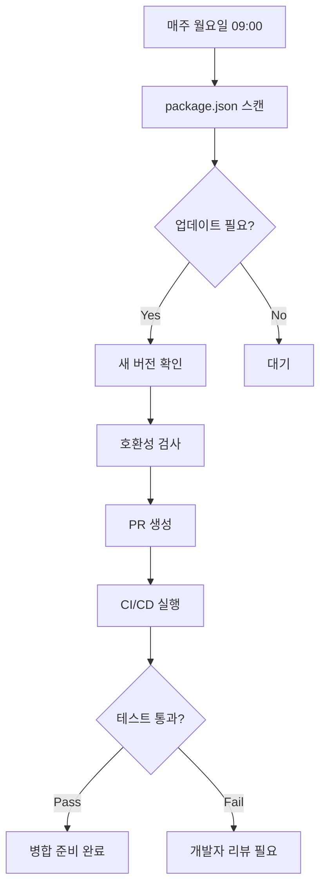

# 📦 Dependabot 완전 가이드

> SokSol 프로젝트에서 Dependabot을 활용한 자동 의존성 관리 완전 가이드

## 📋 목차
- [Dependabot이란?](#dependabot이란)
- [SokSol 프로젝트 설정](#soksol-프로젝트-설정)
- [작동 방식 이해하기](#작동-방식-이해하기)
- [PR 관리 방법](#pr-관리-방법)
- [보안 업데이트 처리](#보안-업데이트-처리)
- [문제 해결](#문제-해결)

---

## 🤖 Dependabot이란?

**Dependabot**은 GitHub에서 제공하는 자동 의존성 관리 도구입니다.

### 🎯 주요 기능
- **자동 의존성 감지**: package.json의 의존성을 주기적으로 스캔
- **보안 취약점 알림**: CVE 데이터베이스와 연동하여 보안 이슈 탐지
- **자동 PR 생성**: 업데이트가 필요한 패키지에 대해 Pull Request 자동 생성
- **호환성 테스트**: CI/CD와 연동하여 업데이트 안전성 검증

### 💡 왜 사용해야 할까?
- ✅ **보안 강화**: 취약점이 있는 패키지 자동 감지
- ✅ **시간 절약**: 수동 의존성 관리 시간 90% 절약
- ✅ **최신 상태 유지**: 최신 기능과 성능 개선 자동 적용
- ✅ **호환성 보장**: CI 테스트와 연동하여 안전한 업데이트

---

## ⚙️ SokSol 프로젝트 설정

### 📁 현재 설정 구조
```yaml
# .github/dependabot.yml
version: 2
updates:
  # 메인 프로젝트 (Next.js)
  - package-ecosystem: "npm"
    directory: "/"
    schedule:
      interval: "weekly"        # 매주 월요일 9시
      day: "monday"
      time: "09:00"
    open-pull-requests-limit: 10

  # 모바일 앱 (React Native)
  - package-ecosystem: "npm"
    directory: "/mobile/soksol_mobile/SokSol"
    schedule:
      interval: "weekly"        # 매주 화요일 9시
      day: "tuesday"
      time: "09:00"

  # GitHub Actions
  - package-ecosystem: "github-actions"
    directory: "/"
    schedule:
      interval: "monthly"       # 매월 1일
```

### 🎛️ 설정 요소 설명

| 설정 | 값 | 설명 |
|------|----|----|
| `package-ecosystem` | `npm` | 패키지 관리자 유형 (npm, yarn, pip 등) |
| `directory` | `/` | 스캔할 디렉토리 경로 |
| `interval` | `weekly` | 스캔 주기 (daily, weekly, monthly) |
| `open-pull-requests-limit` | `10` | 동시에 열 수 있는 최대 PR 수 |
| `automerge` | `false` | 자동 병합 비활성화 (안전성) |

---

## 🔄 작동 방식 이해하기

### 📅 **주기적 스캔 프로세스**



### 🏷️ **PR 라벨링 시스템**

SokSol 프로젝트에서 생성되는 PR 라벨:

- `dependencies`: 일반 의존성 업데이트
- `mobile`: 모바일 앱 관련 업데이트
- `github-actions`: GitHub Actions 워크플로우 업데이트
- `security`: 보안 취약점 수정

### 📝 **커밋 메시지 형식**
```
deps: bump @types/node from 20.0.0 to 20.1.0
deps(mobile): bump react-native from 0.81.0 to 0.81.1
ci: bump actions/checkout from v3 to v4
```

---

## 🔧 PR 관리 방법

### ✅ **안전한 PR 병합 가이드**

#### 1. **패치 업데이트** (예: 1.0.0 → 1.0.1)
- ✅ **일반적으로 안전**: 버그 수정만 포함
- 🔄 **권장 작업**: CI 통과 후 즉시 병합

#### 2. **마이너 업데이트** (예: 1.0.0 → 1.1.0)
- ⚠️ **주의 필요**: 새 기능 포함
- 🔍 **권장 작업**: 
  - 변경 로그 확인
  - 로컬 테스트
  - 스테이징 환경 배포 후 병합

#### 3. **메이저 업데이트** (예: 1.0.0 → 2.0.0)
- 🚨 **위험**: Breaking changes 포함
- 📋 **필수 작업**:
  - 마이그레이션 가이드 검토
  - 전체 기능 테스트
  - 코드 리팩토링 계획 수립

### 🎯 **실제 PR 처리 예시**

```bash
# 1. PR 확인
git checkout main
git pull origin main

# 2. Dependabot 브랜치 체크아웃
git checkout dependabot/npm_and_yarn/types/node-20.1.0

# 3. 로컬 테스트
npm install
npm test
npm run build

# 4. 문제없으면 병합
gh pr merge [PR번호] --merge
```

---

## 🔒 보안 업데이트 처리

### 🚨 **보안 알림 대응 절차**

GitHub에서 보안 취약점이 발견되면 Dependabot이 즉시 PR을 생성합니다.

#### **우선순위 처리**
1. **Critical/High**: 즉시 처리 (24시간 내)
2. **Medium**: 1주일 내 처리
3. **Low**: 다음 정기 업데이트 시 처리

#### **보안 PR 병합 가이드**
```yaml
# 보안 업데이트 예시
Title: "Bump express from 4.17.1 to 4.18.2"
Labels: dependencies, security
Priority: Critical

설명:
- CVE-2022-24999 취약점 수정
- 인증 우회 가능성 해결
- 즉시 업데이트 권장
```

---

## 🛠️ 문제 해결

### ❌ **자주 발생하는 문제들**

#### 1. **PR이 생성되지 않음**
```yaml
# 원인: dependabot.yml 문법 오류
# 해결: YAML 문법 검사
- package-ecosystem: "npm"  ✅
- package-ecosystem: npm    ❌
```

#### 2. **너무 많은 PR 생성**
```yaml
# 원인: open-pull-requests-limit 설정 미흡
# 해결: 제한 수 조정
open-pull-requests-limit: 5  # 적절한 수로 조정
```

#### 3. **CI 테스트 실패**
```bash
# 원인: 의존성 충돌
# 해결: package-lock.json 재생성
rm package-lock.json
npm install
```

#### 4. **모바일 앱 업데이트 실패**
```bash
# 원인: React Native 호환성 문제
# 해결: Metro cache 정리
cd mobile/soksol_mobile/SokSol
npx react-native start --reset-cache
```

### 🔍 **디버깅 방법**

#### **Dependabot 로그 확인**
1. Repository → Insights → Dependency graph
2. Dependabot 탭에서 최근 실행 로그 확인
3. 실패한 업데이트 원인 분석

#### **수동 Dependabot 실행**
```bash
# GitHub CLI 사용
gh api repos/:owner/:repo/dependabot/updates \
  --field state=open
```

---

## 📊 모니터링 및 분석

### 📈 **의존성 건강성 체크**

#### **월간 리포트 확인 항목**
- 📦 업데이트된 패키지 수
- 🔒 해결된 보안 취약점
- ⏱️ 평균 PR 처리 시간
- 🧪 CI 테스트 성공률

#### **유용한 GitHub 명령어**
```bash
# 열린 Dependabot PR 목록
gh pr list --label dependencies

# 보안 관련 PR만 조회
gh pr list --label security

# 특정 패키지 업데이트 이력
gh pr list --search "bump package-name"
```

---

## 🎓 초보자를 위한 단계별 가이드

### 1️⃣ **첫 번째 Dependabot PR 처리하기**

```bash
# 1. 저장소 클론
git clone https://github.com/username/soksol.git
cd soksol

# 2. Dependabot PR 확인
gh pr list --label dependencies

# 3. 첫 번째 PR 체크아웃
gh pr checkout [PR번호]

# 4. 변경 사항 확인
git diff main..HEAD

# 5. 테스트 실행
npm test

# 6. 문제없으면 병합
gh pr merge [PR번호] --squash
```

### 2️⃣ **설정 커스터마이징**

```yaml
# .github/dependabot.yml 수정 예시

# 업데이트 주기 변경
schedule:
  interval: "daily"    # 매일 체크
  time: "02:00"       # 새벽 2시

# 특정 패키지 제외
ignore:
  - dependency-name: "lodash"
    versions: ["4.x"]

# 그룹화 설정
groups:
  production-dependencies:
    dependency-type: "production"
  development-dependencies:
    dependency-type: "development"
```

---

## 💡 **베스트 프랙티스**

### ✅ **권장 사항**
- 🔄 **정기적 검토**: 주 1회 Dependabot PR 일괄 검토
- 📋 **테스트 우선**: 모든 업데이트는 CI 테스트 통과 필수
- 🔒 **보안 우선**: 보안 업데이트는 최우선 처리
- 📝 **변경 로그 확인**: 메이저 업데이트 시 Breaking Changes 검토

### ❌ **피해야 할 것들**
- 🚫 **무분별한 자동 병합**: 모든 업데이트를 자동 병합하지 말 것
- 🚫 **메이저 버전 자동 적용**: Breaking Changes 가능성
- 🚫 **테스트 생략**: CI 실패 시에도 강제 병합 금지
- 🚫 **의존성 무시**: 오래된 의존성 방치 금지

---

## 🔗 **유용한 링크**

- [GitHub Dependabot 공식 문서](https://docs.github.com/en/code-security/dependabot)
- [Semantic Versioning 가이드](https://semver.org/)
- [NPM 보안 감사](https://docs.npmjs.com/cli/v8/commands/npm-audit)
- [SokSol 프로젝트 Dependabot 설정](../.github/dependabot.yml)

---

## 📞 **도움이 필요할 때**

1. **GitHub Issues**: 프로젝트 관련 문제 제기
2. **GitHub Discussions**: 일반적인 질문과 토론
3. **공식 문서**: 상세한 설정 가이드 참조

---

*이 가이드는 SokSol 프로젝트의 실제 사용 사례를 바탕으로 작성되었습니다. 궁금한 점이 있으면 언제든 Issues를 통해 문의해주세요! 🚀*
